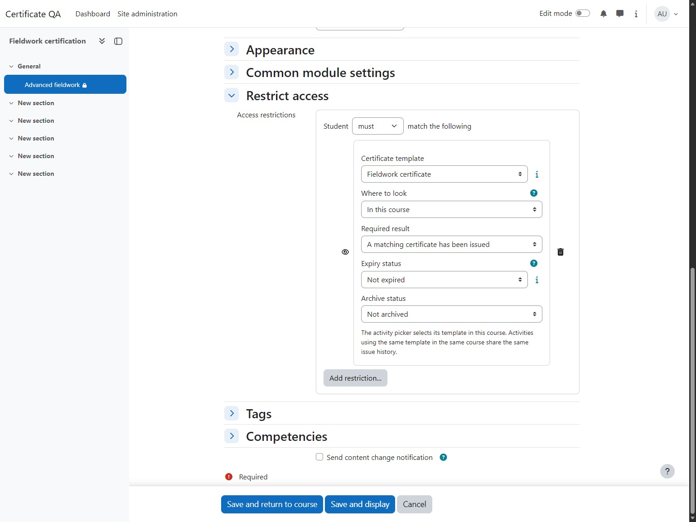
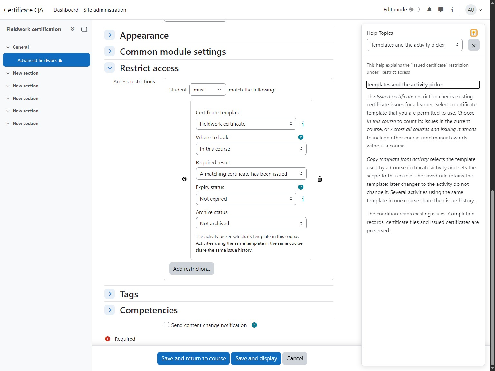
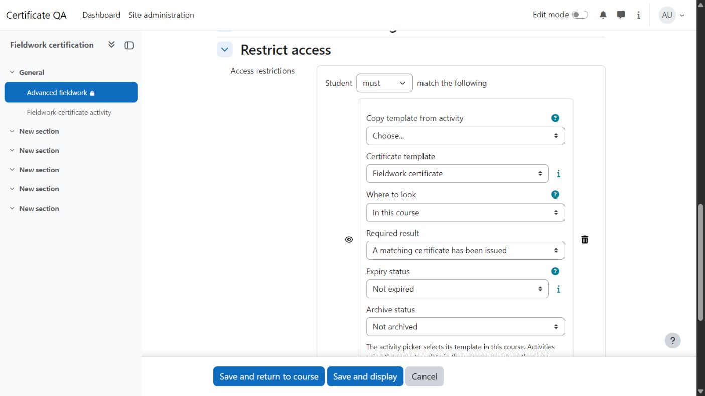

<!--
This file is part of Moodle - https://moodle.org/

Moodle is free software: you can redistribute it and/or modify
it under the terms of the GNU General Public License as published by
the Free Software Foundation, either version 3 of the License, or
(at your option) any later version.

Moodle is distributed in the hope that it will be useful,
but WITHOUT ANY WARRANTY; without even the implied warranty of
MERCHANTABILITY or FITNESS FOR A PARTICULAR PURPOSE.  See the
GNU General Public License for more details.

You should have received a copy of the GNU General Public License
along with Moodle. If not, see <https://www.gnu.org/licenses/>.

@package    availability_certificateissued
@copyright  2026 Andreas Giesen <andreas@108design.com>
@license    https://www.gnu.org/copyleft/gpl.html GNU GPL v3 or later
-->

  

# Restriction by issued certificate

Restrict access to Moodle activities and course sections based on certificates a learner has received. Use an issued certificate as an entry requirement, or offer a replacement certificate only to learners who have yet to receive the previous one.

Screenshots

<table>
<tr>
<td width="50%" valign="top"> <strong>Certificate restriction in the activity settings</strong> Choose a certificate template and set the scope, expiry and archive filters.</td>
<td width="50%" valign="top"> <strong>Contextual help in the activity editor</strong> Open help on certificate selection, issue status, replacement and restore.</td>
</tr>
<tr>
<td colspan="2"> <strong>Copy a template from a course certificate activity</strong> Choose an eligible activity to copy its template and set the scope to the current course.</td>
</tr>
</table>

## Requirements

- Moodle LMS 4.5 through 5.3 with restricted access enabled.
- [Workplace certificate manager](https://marketplace.moodle.com/plugins/tool_certificate) (`tool_certificate`, build 2022112800 or newer). Select an upstream release for your Moodle branch. For 5.3, use Certificate manager 5.0.12 or later with 5.3 support.
- Optional [Course certificate](https://marketplace.moodle.com/plugins/mod_coursecertificate) (`mod_coursecertificate`) for the activity picker. Use an upstream release that supports your Moodle branch. The picker appears when a certificate activity in the course uses a template you are allowed to select.

## Install

Install the release ZIP through **Site administration → Plugins → Install plugins** and complete the Moodle upgrade. For a manual installation, place the plugin in `availability/condition/certificateissued` within Moodle’s public code directory and complete the upgrade.

If you are upgrading from Certificate Issued 1.0.x, install the signed normal release ZIP first. This retains the selected templates and saved restrictions. You can use signed Moodle Marketplace updates from the new release onward.

## Add an issued certificate restriction

In an activity or course section, choose **Restrict access → Add restriction → Issued certificate**. Select a certificate template and configure these settings.

| Setting | Options |
| --- | --- |
| Where to look | In this course or across all courses and issuing methods |
| Required result | A matching certificate has been issued or no matching certificate has been issued |
| Expiry status | Any expiry status, not expired, or expired |
| Archive status | Any archive status, not archived, or archived |

The expiry and archive settings must match the same issued certificate. Certificates with no expiry date count as not expired. Revoked or deleted issues no longer count.

**Copy template from activity** sets the template and selects **In this course**. Activities using the same template in that course share the same issue history. Changing or deleting the activity later leaves the saved template selection in place.

## Replace a certificate

1. Stop further issuance of the old certificate and keep its template and awards.
2. Keep the replacement hidden while you set it up. Add a restriction for the old template and choose **In this course**, **No matching certificate has been issued**, **Any expiry status**, and **Any archive status**.
3. Combine the restriction with the replacement’s completion requirements using **All**.
4. Check with a learner who received the old certificate and one who did not before enabling automatic issuance.

Both **Any** options count all retained issues, including expired and archived certificates. The restriction leaves existing awards and course completions in place.

## Course copies and restore

On the same Moodle site, a copied rule can keep the template if it is available in the destination course. The **In this course** option then looks for issues in the destination course. After restoring on another Moodle site, select the template again. A missing or unrecognised template keeps access restricted until you update the rule.

## Privacy

The plugin saves settings in Moodle’s availability configuration and reads existing issues from Certificate manager. It stores no additional personal data.

## License

Available free of charge under the terms of the applicable license.

See the [GNU General Public License, version 3 or later](LICENSE.md).
